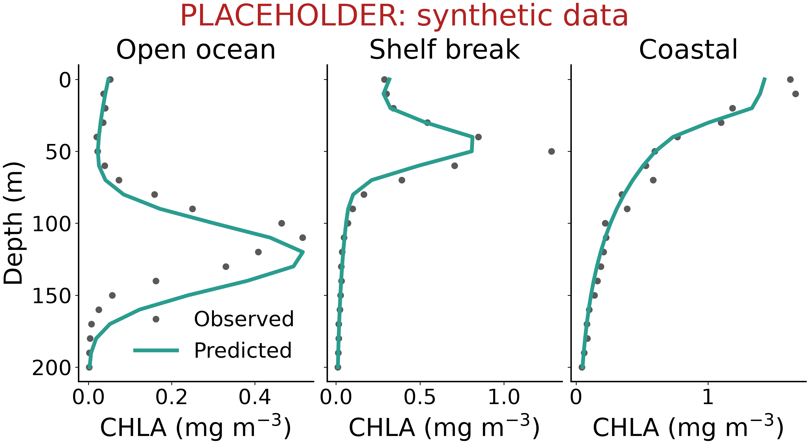
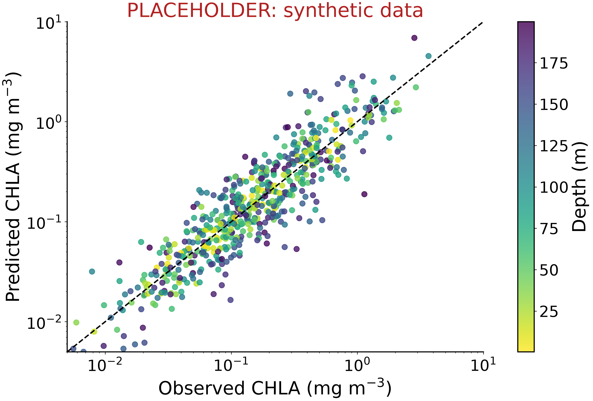

<!--
Poster markup (see README.md):
  ::: {.block title="..."}   a titled box; add .highlight for an accent box
  ::: {.colbreak}            start the next column
  ::: {#refs}                where the references go
  {script="scripts/x.py"}    on a figure, adds a "Code:" link to its caption
Optional YAML: poster-columns (3), poster-width / poster-height (42in), fontsize (32pt).
-->

::: {.block .highlight title="Key Points"}
- Key point one: the single most important finding, in one line.
- Key point two: what is new about the approach.
- Key point three: why it matters.
:::

::: {.block title="Introduction"}
Two or three sentences on the problem and why it matters, with a citation
where it helps [@werdell2019pace].

One or two sentences on earlier work [@sauzede2015] and the gap this work fills.
:::

::: {.block title="Objectives"}
1. Objective one.
2. Objective two.
3. Objective three.
:::

::: {.colbreak}
:::

::: {.block title="Data"}
The data: sources, time span and coverage, in two or three sentences.

- Number of observations and time span.
- Spatial coverage.
:::

::: {.block title="Methods"}
The model or analysis, its inputs and outputs, and how it was evaluated.
:::

::: {.block title="Results"}
{#fig-profiles script="scripts/fig_example_profiles.py" width="100%"}

One or two sentences on what @fig-profiles shows.
:::

::: {.colbreak}
:::

::: {.block title="Results (continued)"}
{#fig-scatter script="scripts/fig_example_scatter.py" width="100%"}

One or two sentences on what @fig-scatter shows.
:::

::: {.block title="Conclusions"}
- Conclusion one.
- Conclusion two.
:::

::: {.block title="Next Steps"}
- Next step one.
- Next step two.
:::

::: {.block title="References"}
::: {#refs}
:::
:::

::: {.block title="Acknowledgements"}
Funding, collaborators and data providers.
:::
