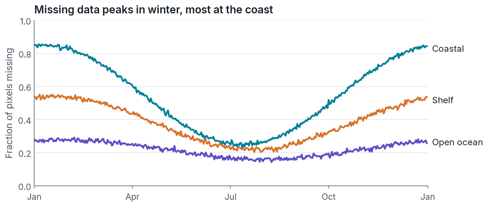
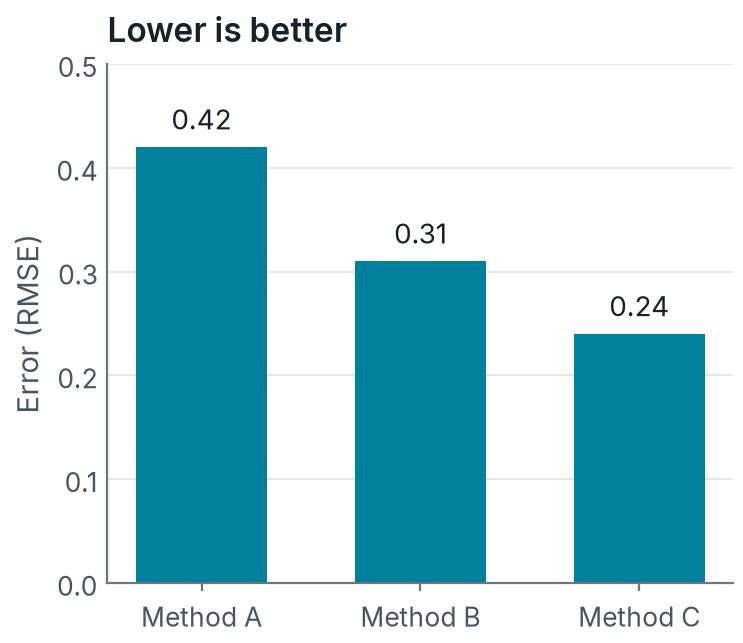

## What this template gives you

- Plain text slides: version control sees every change
- Figures made by scripts in `scripts/`, each linked from its caption
- One theme file (`brand.scss`) for colours and fonts, so a branded variant is a one-line switch
- Speaker notes: press [S]{.accent} to open the speaker view

::: notes
Speaker notes go in a `::: notes` block. They show in the speaker view (press S) and not on the slide.
:::

# Section divider slides come from a level-1 heading

Optional one-line description under it.

## A figure made by a script

{script="scripts/fig_example_lines.py" fig-alt="Three lines showing the fraction of missing pixels through the year; coastal is highest and peaks in winter."}

## Two columns

:::: {.columns}
::: {.column width="48%"}
- Text on one side, figure on the other
- Keep to three bullets
- [Highlight]{.hl} one word, sparingly
:::
::: {.column width="52%"}
{script="scripts/fig_example_bars.py" fig-alt="Bar chart of error for three methods; Method C lowest at 0.24."}
:::
::::

## Big numbers

::: {.stats}
[42%]{.stat} of pixels missing in a typical winter week

[3×]{.stat} more gaps at the coast than offshore

[0.24]{.stat} error after gap filling
:::

::: {.refs}
Numbers on this slide are placeholders.
:::

## Take-away box and lead text

[A `.lead` paragraph is larger, for the one sentence you want remembered.]{.lead}

::: {.takeaway}
Use a take-away box for the conclusion of a slide, once per slide at most.
:::

[Muted text for asides.]{.muted}

## Gaps cluster in winter and near the coast {.statement}

A statement slide: the claim is the title. One optional supporting line.

## Can a model trained on cloudy days fill the gaps on clear ones? {.question}

A question the talk will answer.

## The evidence, full size {.visual}

{script="scripts/fig_example_lines.py" fig-alt="Three lines showing the fraction of missing pixels through the year; coastal is highest and peaks in winter."}

## {.quote}

> All models are wrong, but some are useful.

[George E. P. Box, 1979]{.quote-source}

## The objective {.math}

$$
\mathcal{L} = \frac{1}{|M|} \sum_{i \in M} \left( \hat{x}_i - x_i \right)^2
$$

where $M$ is the set of pixels hidden from the model during training.

## Code {.code}

```python
import xarray as xr

ds = xr.open_dataset("chl.nc")
gaps = ds["chl"].isnull().mean("time")
```

Inline code like `ds.chl` is set in the mono font.

## A diagram

```{mermaid}
flowchart LR
  A[Data] --> B[Batches] --> C[Model] --> D[Evaluate]
```

## A table

| Method   | Error | Run time |
|----------|------:|---------:|
| Method A |  0.42 |     1 min |
| Method B |  0.31 |    20 min |
| Method C |  0.24 |     2 min |

## A callout

::: {.callout-note}
## Built-in Quarto callouts work too
Use them for definitions or caveats.
:::

## Thank you {.dark .closing}

[Questions?]{.lead}

- Slides: [example.github.io/talk](https://example.github.io/talk)
- Contact: name@example.org

::: {.qr}
:::
